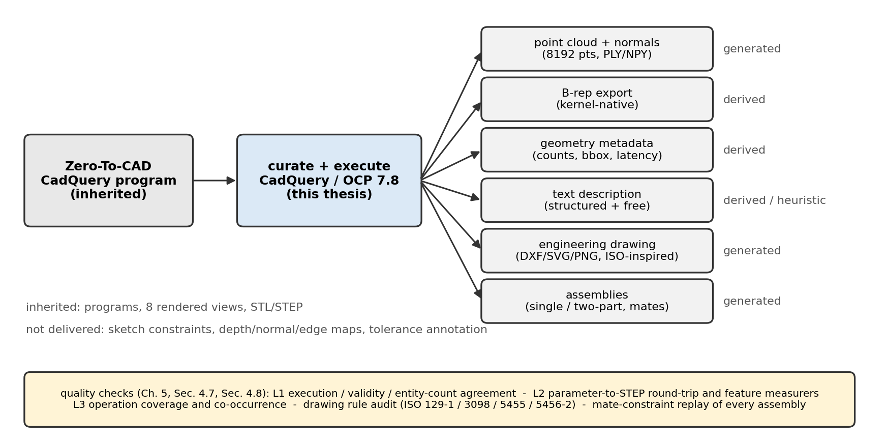
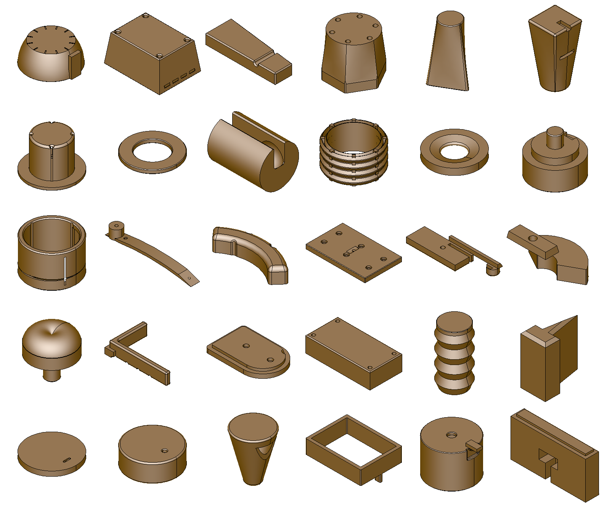
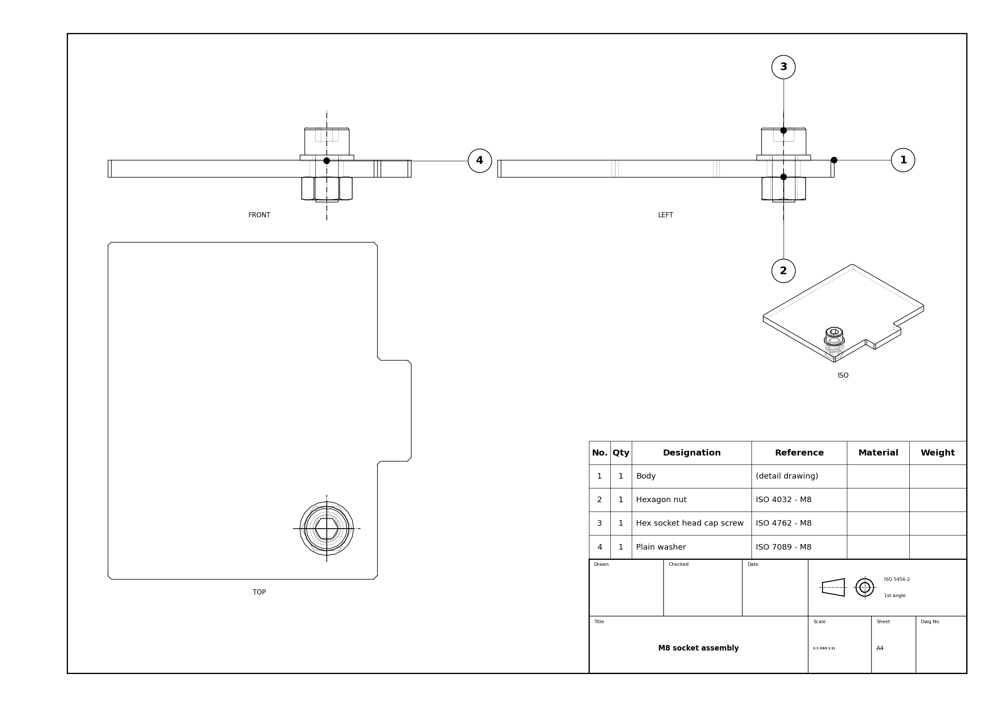
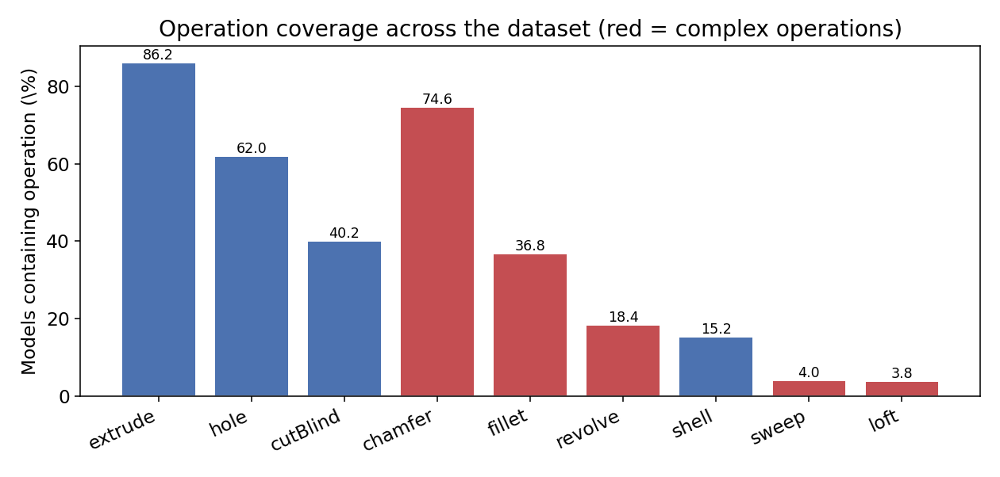
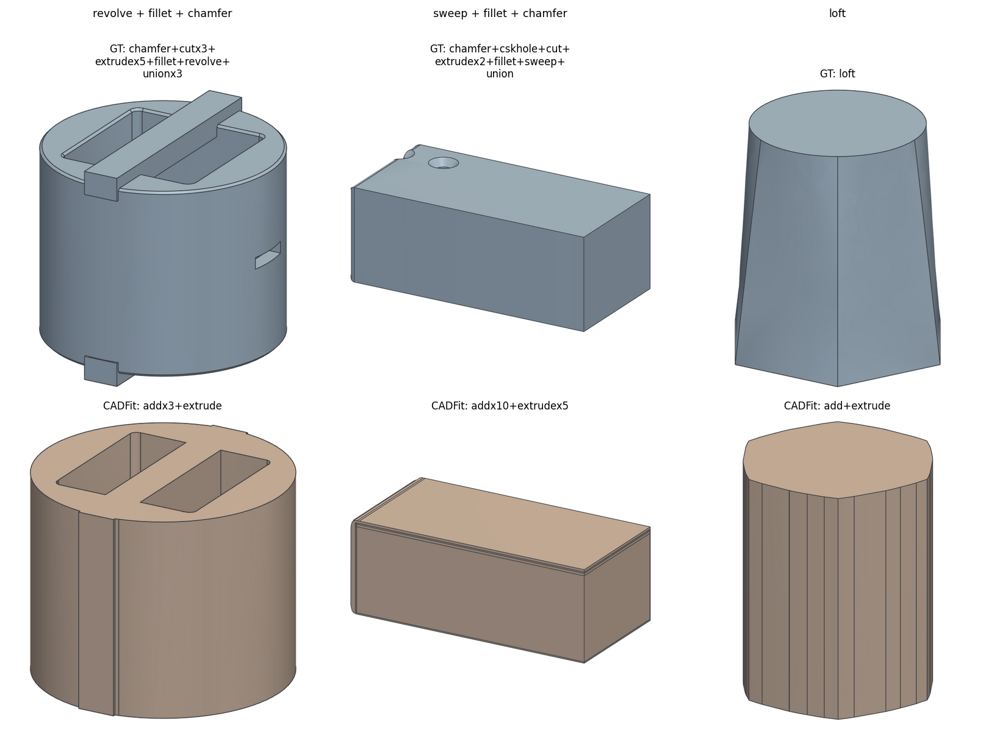

# ComplexCAD

**A multi-modal augmentation of complex CAD programs for point-cloud-to-CAD reconstruction.**

This repository holds the code, environments, data splits, predictions and result
files of the master's thesis *Investigation of Dataset Construction Methods for
Point Cloud to CAD Reconstruction with Complex Modeling Operations* (Jian Xiong,
Technische Universität Berlin, 2026).

The dataset itself, about 53 GB, is too large for git. It is archived with the
examination copy of the thesis and is available on request: open an issue in this
repository.

## Why this dataset

Point-cloud-to-CAD methods such as CAD-Recode and cadrille learn to write an
editable CAD program for a scanned shape. Their public training data share three
gaps:

1. **Operation coverage.** DeepCAD, the Fusion 360 Gallery and CAD-Recode contain
   no loft, revolve, sweep, chamfer or fillet at all. Real mechanical parts use
   these operations constantly.
2. **Parameter precision.** DeepCAD quantises every value to 256 levels and
   CAD-Recode places every value on a 0.5 mm grid. Neither carries named,
   editable parameters.
3. **Missing modalities.** No existing set pairs the programs with point clouds,
   engineering drawings, text descriptions and assemblies.

ComplexCAD closes these gaps on top of an inherited corpus. The 10,000 base
programs come from the test split of Autodesk's
[Zero-To-CAD](https://huggingface.co/datasets/ADSKAILab/Zero-To-CAD-1m), which
already covers the complex operations. The thesis does not generate the base
programs. It adds the modalities that point-cloud-to-CAD training needs and
measures how precisely each program survives execution and export.

| Artifact | Provenance |
|---|---|
| CadQuery programs, operation lists | Upstream (Zero-To-CAD) |
| Eight rendered RGB views, STL, STEP | Upstream (Zero-To-CAD) |
| Point cloud, 8,192 points with mesh-face normals | Generated in this thesis |
| Kernel-native B-rep export (`.brep`) | Derived from the inherited STEP |
| Geometry statistics, metadata | Derived from the inherited STEP |
| Text description: operations, dimensions, geometry | Derived, parsed from the program |
| Text description: design-intent clause | Heuristically inferred |
| Engineering drawings (ISO-inspired) | Generated in this thesis |
| Single- and two-part assemblies | Generated in this thesis |

## Dataset statistics

| Item | Value |
|---|---|
| Single-part models | 10,000 |
| Programs that execute in the pinned environment | 9,982 |
| Models with named parameters | 8,710 |
| Mean modelling operations per model | 24.9 |
| Mean B-rep faces per model | 44.8 |
| Engineering drawings (PNG, SVG, DXF) | 9,996 |
| Assemblies | 1,698 (1,005 single-part, 693 two-part) |
| Topological entity counts reproduced | 87.59 % of models |

Share of models that contain each complex operation:

| Chamfer | Fillet | Revolve | Sweep | Loft | At least one |
|---|---|---|---|---|---|
| 74.6 % | 36.8 % | 18.4 % | 4.0 % | 3.8 % | 95.0 % |

Fixed splits in `splits/`:

| Split | Models | File |
|---|---|---|
| Train | 9,212 | `train.txt` |
| Validation | 100 | `val_100.txt` |
| Test | 400 | `test_400.txt` |
| Quarantine, near-duplicates of a test shape | 271 | `quarantine_near_duplicates.txt` |
| Non-executing programs | 18 | `non_executing_18.txt` |

Never train on the quarantine list. One non-executing model is also in the test
list and is scored as invalid, so the five lists hold 10,001 entries.
Assemblies use `splits/assemblies.json`.

## Comparison with existing datasets

All values were measured first-hand on the downloaded releases (thesis, Chapter 3).

| Dataset | Analysed | Parameter values | Explicit parameters | Models with a complex operation |
|---|---|---|---|---|
| DeepCAD | 8,052 (test) | integers in [0, 255] | positional only | 0 % |
| Fusion 360 Gallery | 8,625 (reconstruction) | continuous | unnamed fields | 0 % |
| CAD-Recode v1.5 | 981,865 (train) | 0.5 mm grid | literals only | 0 % |
| Zero-To-CAD | 10,000 (test) | continuous | named, 8,710 of 10,000 | 95.0 % |
| **ComplexCAD** | 10,000 | continuous, inherited | named, inherited | 95.0 %, inherited |

ComplexCAD adds to the Zero-To-CAD programs the point clouds, B-rep exports, text
descriptions, drawings, assemblies and the measured precision described above.
The Fusion 360 Gallery is the only one of these datasets that records sketch
constraints. ComplexCAD does not add constraint ground truth.

## Examples

Pipeline overview:



Thirty example parts from the release:



An automatically generated engineering drawing:



Operation coverage over the release:



Ground truth (top) and the CADFit reconstruction (bottom) of three complex-operation test models. The shape fits, but every complex operation is replaced by extrusions and Boolean unions:



## Quick start

### 1. Install

```bash
git clone https://github.com/jianx-gif/complexcad.git
cd complexcad
conda env create -f env/environment-cadfit.yml     # pipeline and evaluation
conda activate cadfit-env
```

The audit scripts use `env/environment-cadquery.yml`. Training uses a separate
virtual environment:

```bash
python -m venv cadrec_env
cadrec_env/Scripts/pip install -r env/requirements-training.txt   # Windows
# cadrec_env/bin/pip install -r env/requirements-training.txt     # Linux
```

The pinned versions are CadQuery 2.6.1, OCP 7.8.1, trimesh 4.11.5 and ezdxf 1.4.4
for the pipeline, and Python 3.13, PyTorch 2.6.0 with CUDA 12.4, Transformers
4.50.3 and PEFT 0.20.0 for training.

### 2. Get the data

Request the data archive as described at the top of this page and extract it into
the repository root. You then have `output/<uuid>/` for every part, and
`1m_Convert/assemblies_slim/` and `1m_Convert/two_part_assemblies_slim/` for the
assemblies.

### 3. Load one model

```python
import json
import numpy as np

uuid = "31d4bb86-0545-3475-30fa-96ba18d87b54"
d = f"output/{uuid}"

cloud = np.load(f"{d}/point_cloud.npy")          # (8192, 6): xyz in mm + normal
program = open(f"{d}/cadquery.py").read()        # executable CadQuery program
desc = json.load(open(f"{d}/description.json"))  # operations and named parameters
meta = json.load(open(f"{d}/metadata.json"))     # operation list, geometry stats

print(desc["operation_counts"])
print(meta["geometry_stats"]["bbox_dims"])
```

Run the program to get the solid:

```python
import cadquery as cq
ns = {}
exec(program, ns)
```

## Data format

Each part directory `output/<uuid>/` contains:

| File | Content | Provenance |
|---|---|---|
| `cadquery.py` | executable CadQuery program with named parameters | upstream |
| `model.step`, `model.stl` | exact and tessellated geometry | upstream |
| `image_0.png` … `image_7.png` | eight rendered views | upstream |
| `model.brep` | kernel-native OpenCASCADE B-rep | derived |
| `point_cloud.npy` | float array (8192, 6): xyz in millimetres and unit normal | generated |
| `point_cloud.ply` | the same points, for viewers | generated |
| `metadata.json` | parsed operation list, face/edge/vertex counts, bounding box | derived |
| `description.json` | operation sequence and counts, named parameters, dimensions | derived |
| `description.txt` | the same as one paragraph of text, plus a design-intent sentence | derived |
| `drawing.png`, `drawing.svg`, `drawing.dxf` | three-view drawing with dimensions and title block | generated |

An excerpt of `description.json`:

```json
{
  "operation_sequence": ["rect", "sweep", "fillet", "chamfer", "extrude", "cut",
                         "extrude", "union", "cskHole", "rect", "rect"],
  "operation_counts": {"rect": 3, "sweep": 1, "fillet": 1, "chamfer": 1,
                       "extrude": 2, "cut": 1, "union": 1, "cskHole": 1},
  "parameters": {"bracket_length": 80.0, "channel_width": 30.0,
                 "fillet_radius": 2.0, "countersink_angle": 82.0,
                 "chamfer_size": 1.0}
}
```

The matching `description.txt` begins:

```text
The part is built in 11 modelling steps: rect; sweep a profile along a path;
round an edge with a fillet; bevel an edge with a chamfer; ... Key dimensions --
lengths: bracket_length=80, channel_width=30; ... The part spans 80.1 x 40.0 x
30.0 mm and has 24 faces, 57 edges, 35 vertices.
```

Each assembly directory holds `assembly.json`, `assembly_constraints.json`, an
assembly program with and without explicit constraints, `model.step`,
`model.stl`, the drawing in three formats and the part folders.

## Regenerating the added modalities

The scripts are importable modules. Paths are relative to the repository root.

```python
# augment one part in place: point cloud, B-rep, metadata, description
from augment_data import augment
augment("31d4bb86-0545-3475-30fa-96ba18d87b54")

# point cloud and normals from any STL, geometry statistics from a STEP
from augment_data import sample_point_cloud, load_step, geometry_stats
pts, normals = sample_point_cloud("output/<uuid>/model.stl", n=8192)
stats = geometry_stats(load_step("output/<uuid>/model.step"))

# drawing for one part
from make_drawings import process
process("<uuid>", fmts=("png", "svg", "dxf"))

# the operation parser and operation recovery used in Chapter 6
import sys; sys.path.insert(0, "1m_Convert/koor")
from eval_predictions import parse_ops, op_recovery
code = open("predictions/cadrille_cc/<uuid>.py").read()
op_recovery(parse_ops(code), ["extrude", "revolve", "fillet"])
```

Batch commands:

```bash
python -X utf8 augment_data.py [start] [count]      # all parts in output/
python -X utf8 make_drawings.py <uuid>               # one drawing
python -X utf8 regen_all.py 0 10000                  # all drawings
python -X utf8 1m_Convert/batch_assemble.py 1000 --fastener socket
python -X utf8 1m_Convert/koor/eval_precision.py     # precision metrics
```

`1m_Convert/` is also an installable package with a command-line interface:

```bash
cd 1m_Convert
pip install -e .
koor --help
python -m pytest tests -q
```

## Reproducing the experiments

Every table of Chapters 4 to 6 is produced by a script `_review/exp_*.py`. Its
output is the `.json` file of the same name next to it. `MANIFEST.md` maps each
table to its script and result file. `checksums.txt` lists the SHA-256 of every
split, environment and result file.

The main closed loop fine-tunes the released cadrille checkpoint on ComplexCAD
and, as a control, on sketch-and-extrude data:

```bash
python -X utf8 _review/exp_p_prep.py
python -X utf8 _review/exp_p_strip.py
cadrec_env/Scripts/python -X utf8 cadrille_repro/train_closed_loop.py \
    --rank 16 --epochs 3 --data _review/cc_full --out _review/cc_full_lora
cadrec_env/Scripts/python -X utf8 cadrille_repro/run_cadrille.py \
    --mode pc --batch 4 --pc-scale100 --max-new-tokens 900 \
    --outdir cadrille_cc --adapter _review/cc_full_lora/final_adapter
python -X utf8 1m_Convert/koor/eval_predictions.py --method cadrille_cc \
    --pred-dir predictions/cadrille_cc --names-file splits/test_400.txt
python -X utf8 _review/exp_j_perop_prf.py
python -X utf8 _review/exp_bb_loop_significance.py
```

All experiments ran on one laptop with an RTX 4080 Laptop GPU (12 GB).

Main results:

| Measurement | Result |
|---|---|
| Programs that execute | 9,982 of 10,000 |
| Topological entity counts reproduced, pinned kernel | 87.59 % |
| Entity counts agreeing between two modern kernels | 99.6 % |
| Drawings generated without per-model tuning | 9,996 of 10,000 parts, all 1,698 assemblies |
| Complex-operation macro-F1, cadrille fine-tuned on ComplexCAD | 0.189 to 0.267 over three runs |
| The same, control arm trained on sketch-and-extrude data | 0.000 |

Training on ComplexCAD teaches the model the complex operations and named
parameters. It also lowers the share of valid programs, and per-feature
precision does not improve.

## Repository layout

| Path | Content |
|---|---|
| `augment_data.py` | point cloud, B-rep, metadata and text description per part |
| `make_drawings.py`, `drawing.py`, `projlib.py`, `match.py`, `annotate.py`, `params.py`, `iso_knowledge.py`, `regen_all.py` | engineering-drawing chain |
| `1m_Convert/` | assembly chain and the installable `koor` package: precision metrics, prediction scoring, CLI, tests |
| `Dataset Distribution/scripts/` | survey of the four existing datasets, Chapter 3 |
| `cadrille_repro/`, `cadrecode_repro/`, `cadfit_repro/` | reconstruction baselines with the thesis's run scripts, under their own licences |
| `z2c_repro/` | inference with the upstream Zero-To-CAD model |
| `real_root/` | real-part spot check on GrabCAD meshes; the meshes are not included |
| `render_gallery/` | figure rendering from STEP |
| `predictions/` | programs predicted by every evaluated method and training arm |
| `splits/`, `env/` | fixed splits and pinned environments |
| `_review/` | experiment scripts, result files, per-model records, logs and the human audit sheets |
| `third_party_patches/` | the thesis's changes to the upstream baseline code |
| `docs/` | images of this README |

## Known limitations

- The drawings are ISO-inspired, not ISO-compliant. The DXF files define no line
  types or line weights, and holes carry no centre lines.
- The text descriptions are generated from the program. A model that reads them
  is partly given the answer, so they are not independent supervision.
- No sketch-constraint ground truth is provided.
- The closed loop scales coordinates in millimetres by 1/100 without centring.
  The released cadrille checkpoint expects a centred unit-cube cloud instead.
- Four parts have no drawing because hidden-line removal exceeded 30 minutes.
  They are listed in `output_missing_drawings.txt`.

## FAQ

**Which split do I train on?** Use `splits/train.txt` and evaluate on
`splits/test_400.txt`.

**Why do 18 programs not execute?** They failed in the full-corpus run although
they executed upstream. They keep their other modalities and belong to no split.

**Which kernel version?** OCP 7.8.1 with CadQuery 2.6.1, as pinned in
`env/environment-cadfit.yml`.

**Where are the trained adapters?** The LoRA adapters of every training arm are in
the data archive. Their checksums are in `checksums.txt`.

## Citation

```bibtex
@misc{complexcad2026,
  author       = {Xiong, Jian},
  title        = {ComplexCAD: a multi-modal augmentation of complex CAD programs},
  year         = {2026},
  note         = {Master's thesis, Technische Universit\"at Berlin; derived from the
                  Zero-To-CAD corpus (Apache~2.0). Code MIT, derived data CC~BY~4.0.},
  howpublished = {\url{https://github.com/jianx-gif/complexcad}}
}
```

Please also cite Zero-To-CAD, whose programs this dataset builds on:

```bibtex
@article{zerotocad,
  author  = {Ataei, Mohammadmehdi and Askari, Farzaneh and Malekshan, Kamal Rahimi
             and Jayaraman, Pradeep Kumar},
  title   = {{Zero-to-CAD}: Agentic Synthesis of Interpretable {CAD} Programs at
             Million-Scale Without Real Data},
  journal = {arXiv preprint arXiv:2604.24479},
  year    = {2026}
}
```

## Licence

| Part | Licence |
|---|---|
| Code written for the thesis | MIT, see `LICENSE` |
| Data added by the thesis: point clouds, B-rep exports, metadata, descriptions, drawings, assemblies, splits, predictions, results | CC BY 4.0 |
| Inherited Zero-To-CAD programs, STL, STEP and renders | Apache 2.0, see `THIRD_PARTY.md` |
| `cadrille_repro/` | Apache 2.0 |
| `cadrecode_repro/`, `cadfit_repro/` | CC BY-NC 4.0, non-commercial |

Details and attributions are in `THIRD_PARTY.md`.
